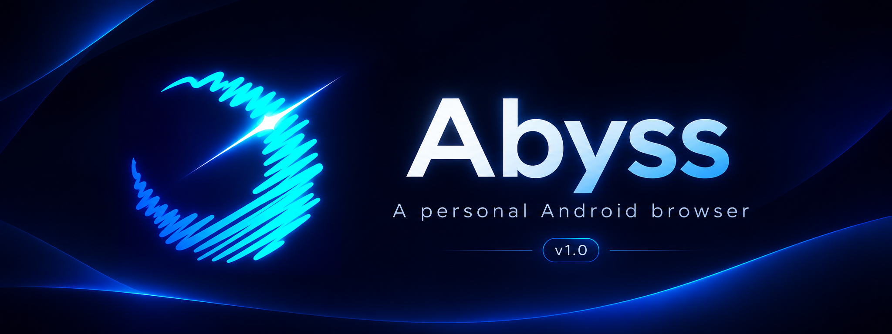
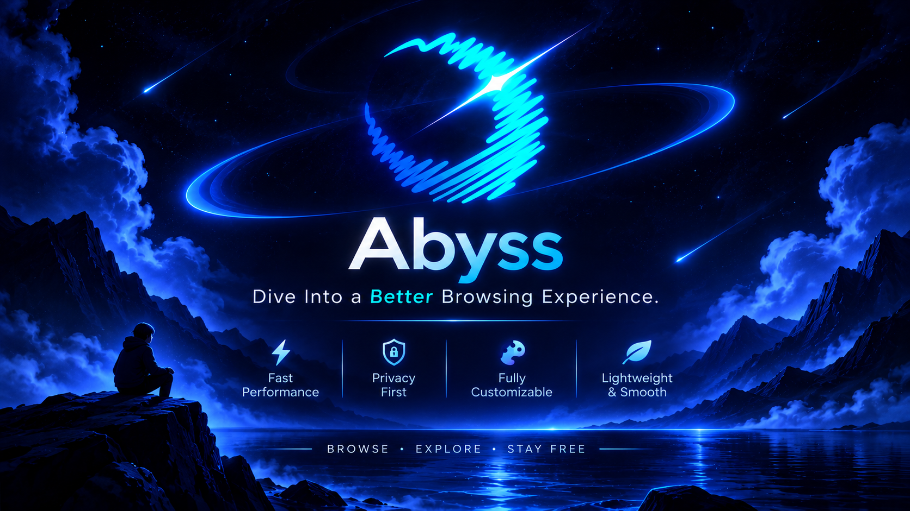
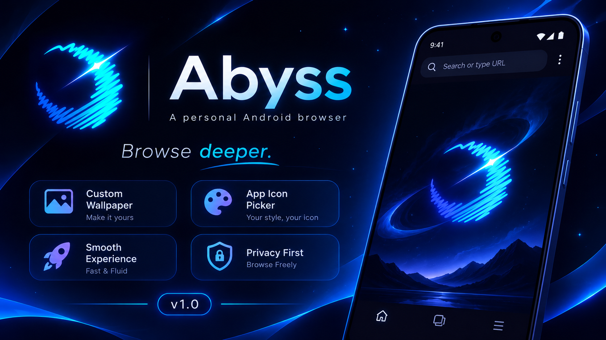
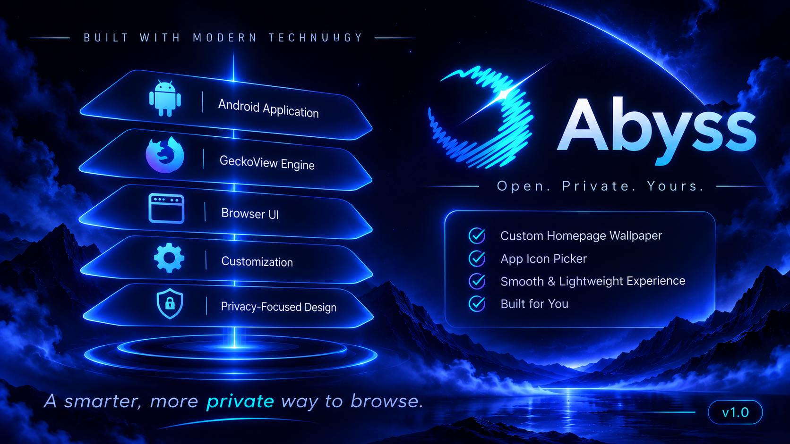

&#x20; 

\# Abyss

\*\*A personal Android browser by Silicon Valley, built on Firefox's engine (GeckoView).\*\*

Abyss is a lightweight, customizable browser for Android. It keeps the speed and compatibility of Firefox's engine and adds a cleaner look, your own homepage wallpaper and a choice of app icons.

&#x20; 

\## Features

&#x20; 

\- \*\*Custom homepage wallpaper.\*\* Pick any image from your gallery in Settings > Home > Choose custom wallpaper, and reset it at any time.

\- \*\*App icon picker.\*\* Choose the icon you like in Settings > Customize.

\- \*\*Animated startup.\*\* A glowing ring plays while Abyss opens.

\- \*\*Clean homepage.\*\* A calm, minimal start page with a search bar.

\- \*\*No keyboard pop-up.\*\* New tabs open without the keyboard jumping up.

\- \*\*Firefox engine.\*\* Websites render the way they do in Firefox for Android.

\## How it is built

&#x20; 

| Layer | What it does |

| --- | --- |

| Android application | The app you install and run on your phone |

| GeckoView engine | Mozilla's engine that loads and displays web pages |

| Browser UI | Tabs, toolbar, menus and the homepage |

| Customization | Wallpaper, app icon picker and theme options |

\## Install

1\. Open the \[Releases](../../releases) page and download `Abyss-release.apk` (arm64, which fits most modern phones).

2\. Open the file on your phone. If Android asks, allow installs from unknown sources.

3\. Open Abyss.

\## Build it yourself

1\. Install the Android SDK, a recent JDK and Python 3.

2\. Clone this repository and run `setup.ps1` once (Windows).

3\. Build a release APK with `gradlew assembleForkRelease`.

The APK appears under `gradle/build/app/outputs/apk/forkRelease/`.

\## Credits

Abyss is built on Iceraven Browser (https://github.com/fork-maintainers/iceraven-browser), Mozilla Firefox for Android (Fenix), GeckoView and Android Components. Thank you to everyone who worked on those.

\## Not affiliated with Mozilla

Abyss is an independent project. It is not made, endorsed, vetted or secured by Mozilla or Iceraven. Firefox and Mozilla are trademarks of the Mozilla Foundation.

\## License

Abyss is released under the \[Mozilla Public License 2.0](LICENSE), the same license as the code it is based on. Original copyright notices are kept in the source files.

