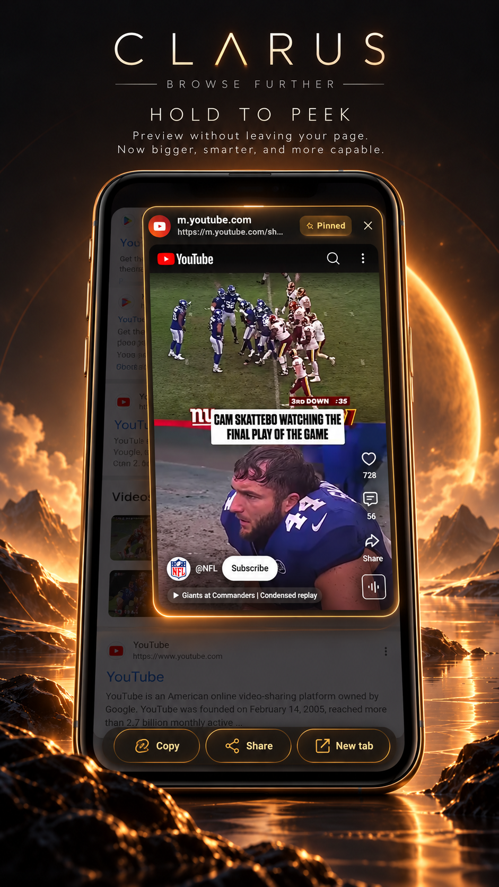
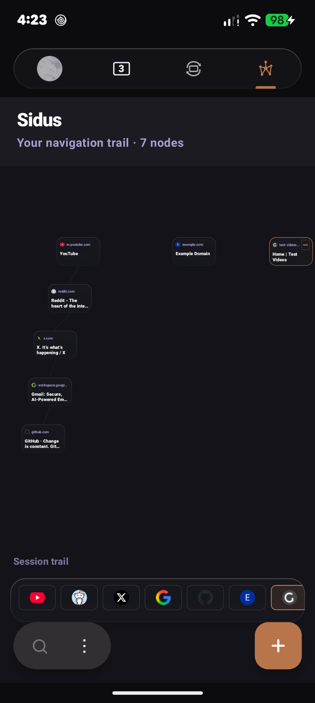

# Clarus Browser 🐉

A Firefox-engine browser for Android with a dragon, a glassy tab tray, and a few tricks up its sleeve.

> **Beta.** It works, I use it, and it has rough edges. See [Known issues](#known-issues) before you get attached.

<p align="center">
  <a href="https://vimeo.com/1233824379?share=copy&fl=sv&fe=ci">
    
  </a>
</p>

<p align="center">
  <a href="https://vimeo.com/1233824379?share=copy&fl=sv&fe=ci"><strong>▶ Watch the Clarus showcase on Vimeo</strong></a>
</p>

## Showcase

### Home

<p align="center">
  
</p>

A clean, focused starting point with the dragon at the center and a minimal search bar at the bottom.

### Private Browsing

<p align="center">
  
</p>

A separate private browsing space with its own visual identity and a cool violet treatment.

### Extensions

<p align="center">
  
</p>

Install and manage compatible browser extensions directly from Clarus, including content blockers, privacy tools, and password managers.

### Hold to Peek

<p align="center">
  
</p>

Press and hold any link and a live, full page preview opens over the page you're on. It's a real page, not a thumbnail, so you can see whether a link is worth opening before you commit to it. Drag in a direction before you let go to decide what happens next.

- **Bigger preview.** The sheet fills most of the screen, and the bottom toolbar slides out of the way while you peek.
- **Gestures, without letting go:**
  - Swipe **up** to open the link in a new tab.
  - Swipe **left** to open it in a private tab.
  - Swipe **right** to **pin** it.
  - Swipe **down** toward the action bar (**Copy**, **Share**, **New tab**) and release over the one you want.
- **Pin it.** A pinned peek stays open after you let go. You can scroll it and interact with it like a normal page. Close it with the X, by tapping the dimmed area outside the sheet, or with Back.
- **Steady sheet.** The preview stays still while you drag, so the action buttons are always where you aimed.
- **No accidental taps.** Actions only fire after you've moved your finger a little, so releasing a plain long press never copies, shares or opens anything by mistake.
- **Adapts to what you hold.** On a direct audio link, "New tab" becomes "Download".
- **Private tabs stay private.** Peeking from a private tab uses a private session.

A peek really loads the page, so the site sees the request just as it would if you had opened the link.

### Clarus Theater

<p align="center">
  
</p>

A dedicated media experience for audio and video, with fullscreen playback and controls designed around mobile use.

You decide what happens when a video goes fullscreen. In Settings, **Fullscreen videos** has three options:

- **Ask** shows a prompt each time. Tick "Remember my choice" and it saves your pick.
- **Always Clarus Theater** sends every fullscreen video to Theater.
- **Always normal fullscreen** skips Theater and uses the regular fullscreen view.

The setting is the same one the prompt writes to, so you can change a remembered choice any time. If Theater can't play a particular video, Clarus quietly falls back to normal fullscreen instead of getting stuck.

### Sidus Trail

<p align="center">
  
</p>

A visual map of your browsing journey. Each tab gets its own branch, with pages represented as connected nodes that you can tap to jump back through your session.

## What's in the box

- **Hold to Peek.** Press and hold a link for a live, scrollable preview. Swipe up for a new tab, left for a private tab, right to pin it, or down to Copy, Share or open it. Pin a peek to keep reading it while you stay on your page.
- **Sidus Trail.** Your browsing history as a map. Each tab gets its own branch, and every page you visit becomes a node in a connected trail. You can see where you started and how you got where you are, and tap any earlier page to jump straight back to it. The trail starts as a blank canvas each new browser session.
- **Glass tab tray.** Your tabs, but frosted and a bit nicer to look at.
- **Clarus Theater.** A built-in player for audio and video, so media gets its own space instead of fighting the page. You choose whether fullscreen uses Theater, the normal view, or asks each time.
- **Haptics.** Little taps where they feel right.
- **Dragon branding.** Orange, dark, and a bit dramatic.
- **A lighter app.** No sign-in, no sync, no VPN. Those were removed on purpose.

## Install

1. Go to the [Releases page](https://github.com/AvGDeV-io/Clarus/releases) and grab the APK. Right now only **arm64-v8a** (most modern phones) has been tested.
2. Check the SHA-256 listed in the release notes against your download.
3. Open the APK. Android will grumble about installing from "unknown sources". You'll need to allow it for whichever app you opened the file with. That's normal for apps outside the Play Store.
4. Open Clarus and you're in.

## Privacy, honestly

Here's what I actually checked, not what sounds nice:

- Telemetry upload is **off**. As far as my audit found, nothing is sent to Mozilla for analytics.
- Crash reporting defaults to **Never**.
- On first launch the browser makes one request to Mozilla's Remote Settings service. That service delivers things like certificate revocation data and blocklists, so I left it on because turning it off would make the browser less safe.
- Normal browsing traffic (the sites you visit, search, safe browsing) goes where you'd expect.
- Hold to Peek loads the real page, so it makes the same requests opening the link would.

The longer version lives in [PRIVACY.md](PRIVACY.md). If you catch Clarus doing something this section doesn't mention, please open an issue. I'd rather know.

## Known issues

It's a beta, so here's the honest list:

- Theater can't play every kind of embedded video. When it can't, Clarus falls back to normal fullscreen on its own, so you may still land in the regular fullscreen view.
- The **Hide system bars** setting only works on some screens (Settings and the home page) for now.
- In Hold to Peek, the faint gesture labels (Private, Pin, Actions) are drawn over the page while you drag. It's cosmetic, but it can sit on top of a site's own buttons.
- Crash reports aren't collected, so if something breaks, tell me what you were doing (a screenshot helps a lot).
- Only the arm64 build has been tested.
- Building from source needs Python installed. The setup script is Windows-only for now, and Linux/Mac get written instructions instead.

## Build it yourself

You don't need `--recursive`. Everything, including `android-components`, lives in this repo.

```
git clone https://github.com/AvGDeV-io/Clarus.git
cd Clarus
```

Then:

1. Install the Android SDK and a recent JDK, and make sure Python 3 is on your PATH.
2. On Windows, run `setup.ps1` once. It creates the Python environment the build needs. On Linux or Mac, follow the same steps by hand (see the comments in `setup.ps1`).
3. Build a debug APK:

```
./gradlew assembleForkDebug
```

Release builds need your own signing key. Don't commit it. `keystore.properties` and `*.jks` are gitignored for a reason.

<!-- TODO: confirm these steps match setup.ps1 before publishing -->

## Found a bug?

[Open an issue](https://github.com/AvGDeV-io/Clarus/issues). Useful things to include: your phone model, Android version, what you tapped, and what you expected to happen. Screenshots welcome.

## Standing on big shoulders

Clarus wouldn't exist without:

- **Mozilla**, for Firefox for Android (Fenix), GeckoView, and Android Components.
- **[Iceraven Browser](https://github.com/fork-maintainers/iceraven-browser)**, the fork Clarus is built on.
- **[akliuxingyuan/android-components](https://github.com/akliuxingyuan/android-components)**, Iceraven's Android Components fork. The vendored copy in this repo starts from commit `56ef46b`.

Thank you to everyone who worked on those. The good parts are theirs. The bugs are probably mine.

## Not affiliated with Mozilla

Clarus is an independent project. It is not made, endorsed, vetted, or secured by Mozilla. Firefox and Mozilla are trademarks of the Mozilla Foundation.

## License

Clarus is released under the [Mozilla Public License 2.0](LICENSE). Original copyright notices and license headers from Mozilla and Iceraven are kept in the source files. If you modify and distribute it, MPL 2.0 asks you to share your changes to those files too.
